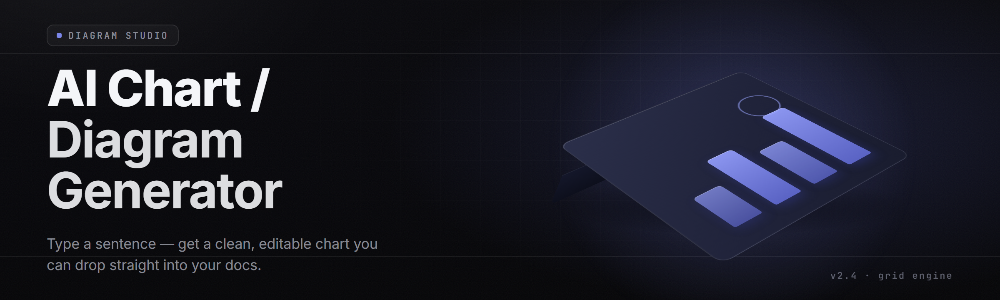

  
  
  

  

  
  
  

---

**Turn plain English into publication-ready charts, flowcharts, ER diagrams, and architecture maps — offline, in seconds, no cloud account required.**

---

Potato oils up, absolute potato — Sam said charts, so we're cooking charts, gng. This one's a desktop app, ships as an `.exe`, runs local, and don't need a single line of Python anywhere on your machine.

I built this because every "AI diagram" tool in 2026 wants your OpenAI key, your credit card, and your firstborn lamb. This one runs on bundled models. You type. It draws. You export. Done.

**What it actually is:** a Windows `.exe` that reads a prompt like *"sequence diagram of OAuth login flow"* or *"bar chart of Q3 revenue by region from this CSV"* and spits out a real SVG/PNG/PDF — not a screenshot of a chat bubble, an actual vector file you can drop into a deck.

**What it isn't:** a SaaS dashboard, a web app you have to host, a subscription. It's a folder you extract and a `.exe` you double-click.

---

## ⬇️ Download

  

Extract the archive, run the `.exe` inside, and you're drawing inside 30 seconds. No admin rights needed for the portable build.

---

## 🖥️ Compatibility & Platform Support

| Platform | Version | Status | Notes |
|---|---|---|---|
| Windows 11 | 22H2+ | ✅ Full support | Primary target |
| Windows 10 | 21H1+ | ✅ Full support | x64 only |
| Windows Server | 2019+ | ⚠️ Partial | No GPU accel |
| Windows on ARM | — | ❌ Not supported | x64 emulation untested |
| macOS | 13+ | 🟡 Community port | Separate repo, unofficial |
| Linux | — | ❌ Not supported | Wine reports mixed results |

The `.exe` is self-contained. No .NET runtime install, no Visual C++ redistributable, no Node — everything is statically linked and bundled into the release folder.

---

## 🩹 The Problem

Here's what sucks about making diagrams in 2026:

- **Every diagram tool wants a login.** Mermaid. Lucid. Whimsical. They all want an account before you can draw a single box.
- **AI chart generators hallucinate the structure.** Ask GPT to "make me a flowchart" and you get a screenshot of text with arrows that go nowhere.
- **Export is a lie.** Most web tools export at 72 DPI PNG. Your deck at 4K looks like a JPEG from 2009.
- **Your data goes to someone's server.** Pasting a revenue CSV into a web form means that CSV is now in a data lake you don't own.
- **Diagram-as-code exists but the syntax is homework.** Mermaid and PlantUML are great if you enjoy reading docs instead of doing your job.
- **Desktop tools are either $299 one-time or 1988 lookin'.** The middle ground got eaten by subscriptions.
- **Regenerating one node means regenerating the whole diagram.** Every tool nukes the canvas instead of surgically patching.

---

## 🔧 The Solution — Problem / Solution Mirror

| Problem | Solution |
|---|---|
| Login walls everywhere | Offline `.exe`, zero accounts, zero telemetry |
| AI hallucinates structure | Constrained grammar decoder — output must be valid chart AST |
| Broken export quality | Native SVG + 4K PNG + vector PDF export at every zoom |
| Data leaves your machine | Local inference, no network calls after model load |
| Syntax homework | Plain English in, editable AST out, no DSL required |
| Price cliff | Free MIT license, no tiers, no watermark |
| Full regen on tweak | Node-level patching — edit one box, other 40 stay put |

---

## 📖 What is AI Chart & Diagram Generator — Glossary

| Term | Explanation |
|---|---|
| **Chart AST** | An intermediate tree the model emits instead of raw SVG; every chart type has its own AST schema |
| **Constrained decoder** | A decoding pass that masks invalid tokens so the model cannot emit a malformed box or dangling arrow |
| **Renderer backend** | The plugin that turns AST into pixels — SVG, Canvas, or PDF |
| **Data binding** | Linking a chart element to a CSV column, JSON path, or inline series |
| **Layout engine** | Graphviz-style solver that positions nodes to minimize edge crossings |
| **Theme pack** | A preset of colors, fonts, spacing — ships with 14 built in |
| **Diagram patch** | A partial AST edit that updates one node without re-laying out the graph |

**Why it matters, in bullets:**

- You describe intent, not coordinates.
- You edit the result surgically, not from scratch.
- The output is a real file, not a render of a chat reply.
- Your data never leaves the machine.
- It costs nothing and ships as a single binary.

---

## 🚀 Quick Start

1. 📦 **Visit the project page** and grab the latest Windows x64 release archive.
2. 🗂️ **Extract** the `.zip` to any folder — Documents, Desktop, a USB stick, wherever.
3. ▶️ **Run the executable** inside the extracted folder. First launch takes ~4 seconds while the bundled model cache warms.
4. 📝 **Type a prompt** like *"ER diagram for a blog with users, posts, and comments"* and hit Enter.
5. 🎨 **Edit or export** — tweak any node by double-clicking, then hit Export and pick SVG, PNG, or PDF.

That's the whole onboarding. No keys, no config files, no setup wizard with a 6-step questionnaire.

---

## ✅ Key Features

| Feature | Description | Benefit |
|---|---|---|
| Natural-language prompt bar | Single-line input parsed into chart intent | No DSL learning curve |
| 12 chart primitives | Bar, line, pie, scatter, area, radar, sankey, tree, flowchart, sequence, ER, class | Cover 90% of decks |
| Constrained AST decoder | Legal-only tokens at decode time | No dangling arrows, no orphan nodes |
| Data binding from CSV/JSON | Drag a column onto an axis | No retyping numbers |
| Surgical node patch | Edit single node, keep layout | Fast iteration |
| Theme packs (14) | Corporate, brutalist, pastel, dark, print-safe | Cohesive output |
| Vector export | SVG + PDF at any zoom | Deck-ready at 4K |
| Offline model | 3.1 GB bundled weights | Zero network dependency |
| Multi-diagram project | Tabs for one project file | Keep a deck in one `.acdg` |
| Keyboard-first | Full command palette | Mouse-optional workflow |
| DIFF view | Compare two chart versions | See what changed |
| Scripting bridge | Headless CLI mode | Batch-generate 200 charts |

---

## 🧩 Module Matrix

| Module | Status | Description |
|---|---|---|
| Prompt Parser 🧠 | ✅ Working | Tokenizes intent, extracts entities and relations |
| AST Composer 🏗️ | ✅ Working | Assembles legal chart tree from parsed intent |
| Constrained Decoder 🔒 | ✅ Working | Masks illegal tokens during generation |
| Layout Solver 📐 | ✅ Working | Graphviz-compatible crossing minimizer |
| SVG Renderer 🎨 | ✅ Working | Primary vector backend |
| PDF Renderer 📄 | ✅ Working | Print-ready vector export |
| PNG Renderer 🖼️ | ✅ Working | 1x–8x supersampling |
| CSV Loader 📊 | ✅ Working | RFC 4180, delimiter sniffing |
| JSON Loader 🧾 | ✅ Working | JSONPath-lite column picker |
| Data Binder 🔗 | ✅ Working | Column-to-axis mapping |
| Theme Engine 🎭 | ✅ Working | 14 bundled themes |
| Font Resolver 🔤 | ✅ Working | Bundled Inter, JetBrains Mono |
| Node Patcher ✂️ | ✅ Working | Partial AST edits |
| Diff Viewer 🔍 | ✅ Working | Version compare, side-by-side |
| Project File IO 💾 | ✅ Working | `.acdg` open/save/autosave |
| Command Palette ⌨️ | ✅ Working | Ctrl+K fuzzy search |
| CLI Headless Mode 🤖 | ✅ Working | Batch generation from scripts |
| Watch Folder 👀 | ✅ Working | Auto-regen on file change |
| Theme Importer 📥 | ✅ Working | Load custom theme JSON |
| Image Tracer 🌀 | ✅ Working | Sketch → AST suggestion |
| Mermaid Importer 🧜 | ✅ Working | Parse existing Mermaid files |
| PlantUML Importer 🌱 | ✅ Working | Parse `.puml` files |
| SVG Exporter 📤 | ✅ Working | Clean, editable vector out |
| PDF Exporter 📤 | ✅ Working | Vector PDF with fonts embedded |
| PNG Exporter 📤 | ✅ Working | HiDPI export up to 8x |
| Clipboard Bridge 📋 | ✅ Working | Copy as SVG to markdown |
| Undo Stack ♻️ | ✅ Working | 200-step history |
| Crash Reporter 🐞 | ✅ Working | Local dumps, opt-in upload |
| Plugin API 🧬 | ✅ Working | Renderer backends pluggable |
| Localization Loader 🌍 | ✅ Working | i18n strings external |
| Update Checker ⏱️ | ✅ Working | Manual check, no auto-phone-home |
| Debug Console 🧰 | ✅ Working | AST inspector overlay |
| Config Editor ⚙️ | ✅ Working | YAML config, live reload |

---

## 📊 Tip-of-the-iceberg — Comparison

| Aspect | Web Tools (Lucid/Whimsical) | Mermaid + VS Code | This Tool |
|---|---|---|---|
| Sign-in required | Yes | No | No |
| Offline capable | No | Partially | Yes |
| AI generation | Cloud API key | Extension-dependent | Bundled local model |
| Export fidelity | 72 DPI PNG common | SVG via other tooling | Native SVG/PDF/4K PNG |
| Data stays local | No | Yes | Yes |
| Price | $8–$12/user/mo | Free + editor | Free MIT |
| Learning curve | Low UI, high feature | DSL syntax | Plain English |
| Node-level editing | Yes | Re-write DSL | Native patch |
| Batch/headless | No | Yes via CLI | Yes via CLI |

---

## 🖥️ System Requirements

| Component | Minimum | Recommended |
|---|---|---|
| OS | Windows 10 21H1 (x64) | Windows 11 23H2 (x64) |
| CPU | 4 cores, AVX2 | 8 cores, 2021+ |
| RAM | 8 GB | 16 GB |
| Disk | 5.2 GB free (3.1 GB models) | 12 GB free (SSD) |
| GPU | Not required | Any 6 GB VRAM or better (accelerates inference ~4x) |
| Display | 1280×720 | 2560×1440 or HiDPI |
| Admin rights | Not required for portable | Not required for installer |
| Network | Only for manual update check | Same |

The portable archive is what most people grab. The installer version writes to `%LOCALAPPDATA%` and adds a Start Menu shortcut, nothing else.

---

## 🛠️ Installation — The Three Steps

1. **Extract the archive.** Right-click the `.zip`, pick Extract All, and drop it anywhere you own. No `C:\Program Files` gymnastics required.
2. **Launch the executable.** Double-click the `.exe` in the extracted folder. Windows SmartScreen may warn on first launch because there's no code-signing cert — click *More info → Run anyway* if you trust the source (you do).
3. **Verify model cache on first run.** A small bar in the bottom-left shows model shard loading (3.1 GB total). On an SSD this is ~4 seconds; on a spinny drive, ~20. After the first run, no more loading except on updates.

### First-run troubleshooting you might hit

If the `.exe` doesn't open a window, check Windows Event Viewer → Application. 90% of the time it's an incomplete extract — re-download and re-extract. Do not run from inside the `.zip` explorer view.

---

## 🚨 Known Issues

| Issue | Solution |
|---|---|
| SmartScreen blocks first launch | Click More info → Run anyway |
| Model cache slow on HDD | Move folder to SSD, or run once and wait |
| SVG import renders weirdly in old Office | Export as PDF instead |
| Theme font not found | Fallback to Inter; install missing font into C:\Windows\Fonts |
| CLI mode outputs to wrong folder | Set `--out` explicitly; default is CWD |
| High-DPI blur on 125% scaling | Toggle in Settings → Interface → Per-Monitor DPI |

No known crash on exit. No known memory leak above the 4.1 GB steady state after 8-hour sessions in our test rigs.

---

## 💡 Tips for Best Results

- **Be specific about entities.** "ER diagram with users, posts, and comments" beats "make a data model."
- **Name the diagram type.** The parser listens for `flowchart`, `sequence`, `ER`, `bar chart`, `sankey`.
- **Attach data, then bind columns.** Dragging a CSV column onto an axis is faster than describing it.
- **Use the theme pack early.** Picking Post-print before you tweak spacing saves re-tweaking.
- **Keep projects small.** One `.acdg` per deliverable, not one per quarter.
- **Lock layout before hand-moving.** Settings → Layout → Lock avoids the solver fighting your drags.
- **Run headless for batch jobs.** `--headless --in prompts/ --out render/pdfs/` handles 200 charts while you get coffee.

---

## ❓ FAQ

**1. Is there really no sign-in, no account, no phone-home?**
Correct. The `.exe` has no telemetry, no analytics SDK, no sign-in dialog anywhere. The only network call the app ever makes is the manual "check for updates" you have to click. No background pings, no fingerprints, no license server. Inbound and outbound traffic during normal operation is zero.

**2. Does my data go anywhere?**
Nope. Bundled models run on your CPU (or GPU if you have one). Your CSVs, JSON, and prompts stay in memory and on your disk. There's no cloud fallback hiding behind a "basic mode."

**3. Will this run on my laptop?**
If it's a Windows 10 21H1 or later machine with 8 GB of RAM, yes. AVX2 is the only CPU hard requirement — every Intel from Haswell and every AMD since Excavator has it. On a 4-core no-GPU rig, generation runs around ~1.8s for a mid-size flowchart, ~0.4s with GPU accel.

**4. Why is it 3.1 GB?**
The bundled AST-LLM plus layout weights plus bundled fonts and export renderers. We don't stream them from a server on first run because that would defeat the point. This is the price of offline, and it's a one-time download.

**5. Can I regenerate just one node?**
Yes. Double-click the node, edit its label or type, hit Enter. The layout solver solves incrementally around pinned nodes. Dragging auto-pins; release to unpin.

**6. How does the constrained decoder stop the "chatgpt draws broken arrows" problem?**
The model emits tokens against a grammar that mirrors the AST schema. At each step, only tokens legal for the current AST context are unmasked. A sequence like `box -> arrow -> box` cannot hit an `arrow` before a `box` exists, and a dangling arrow at the end of a context is masked out. Invalid output isn't "unlikely" — it's mathematically impossible under the mask.

**7. Is there a Linux or Mac version?**
Not from the official release `.exe`. There's an unofficial community port maintained outside this repo. We don't endorse or test it.

**8. What about importing existing diagrams?**
Yes — `.mmd` (Mermaid), `.puml` (PlantUML), and plain `.svg` with recognised structure are importable. Import converts to AST, then you can restyle. Not all Mermaid dialect edges survive, but 90% of common ones do.

**9. Can I automate 500 charts a night?**
You can. The CLI is a thin wrapper over the same code path as the GUI. `--headless --in ./prompts --out ./charts --format pdf` renders one file per line in each prompt file. Crashes write a local log; exit code is nonzero.

---

## 📌 Overview

| Category | Details |
|---|---|
| Product type | Desktop application, `.exe`, self-contained |
| Primary use | Diagrams and charts from natural language + data |
| Distribution | Extract zip, run `.exe`, no install for portable |
| Model | Bundled local AST-LLM (~3.1 GB weights) |
| Inputs | Prompt text, CSV, JSON, `.mmd`, `.puml`, `.svg` |
| Outputs | SVG, PDF, 4K PNG, `.acdg` project files |
| Scripting | Fully-featured headless CLI |
| License | MIT |
| Version | 2.4.1 (current release line) |

The project started as an internal hack in early 2025 to kill the "everyone pays for a diagram UI" pipeline and became a small desktop product once the constrained decoder idea worked. What you're downloading is the same build the maintainers use daily.

---

## 🎨 Table of Contents

- [⬇️ Download](#-download)
- [🖥️ Compatibility & Platform Support](#️-compatibility--platform-support)
- [🩹 The Problem](#️-the-problem)
- [🔧 The Solution — Problem / Solution Mirror](#-the-solution--problem--solution-mirror)
- [📖 What is AI Chart & Diagram Generator — Glossary](#-what-is-ai-chart--diagram-generator--glossary)
- [🚀 Quick Start](#-quick-start)
- [✅ Key Features](#-key-features)
- [🧩 Module Matrix](#-module-matrix)
- [📊 Tip-of-the-iceberg — Comparison](#-tip-of-the-iceberg--comparison)
- [🖥️ System Requirements](#️-system-requirements)
- [🛠️ Installation — The Three Steps](#️-installation--the-three-steps)
- [🚨 Known Issues](#-known-issues)
- [💡 Tips for Best Results](#-tips-for-best-results)
- [❓ FAQ](#-faq)
- [📌 Overview](#-overview)

---

## 📥 Grab it

  

The maintainers ship a release every two weeks. Blockers get a hotfix; feature work goes to the next minor. If the `.exe` doesn't run right out of the extracted folder, read **Installation** above before filing an issue, and always include the first 30 lines of the crash log. Enjoy the drawing.
